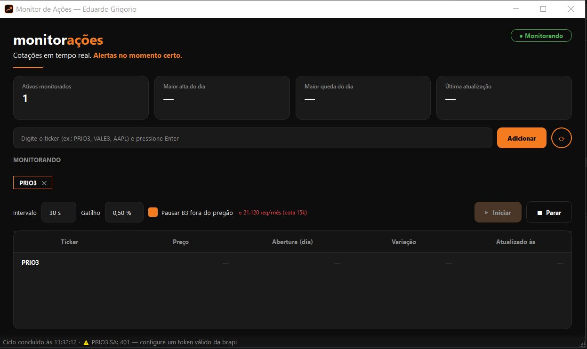

<div align="center">

# Design System Visual

### Um design system visual para criar sistemas consistentes em qualquer área

<p>
  <a href="./design-orange-system.md"></a>
  <a href="https://www.python.org/"></a>
  <a href="https://www.riverbankcomputing.com/software/pyqt/"></a>
  <a href="./design-orange-system.md"></a>
</p>

<p>
  <strong>Uma base visual comum para aplicações desktop, web, mobile, dashboards e ferramentas internas.</strong>
</p>

</div>

---

## O que é este repositório?

O `design-system-visual` é um **design system visual e técnico** para orientar a criação de diferentes tipos de sistemas, modelos de negócio e funções.

Ele existe para que cada novo projeto não precise começar do zero. A interface pode mudar de finalidade e de tecnologia, mas deve manter uma linguagem visual profissional, organizada e coerente.

> **Ideia central:** uma mesma identidade visual pode ser adaptada para diferentes produtos sem perder consistência.

## Onde utilizar

<table>
  <tr>
    <td><strong>Sistemas administrativos</strong><br>Operação, gestão e backoffice.</td>
    <td><strong>Dashboards</strong><br>Indicadores, métricas e relatórios.</td>
    <td><strong>Ferramentas internas</strong><br>Fluxos técnicos e operacionais.</td>
  </tr>
  <tr>
    <td><strong>Sistemas comerciais</strong><br>Vendas, clientes e processos.</td>
    <td><strong>Aplicações desktop</strong><br>Python e PyQt6.</td>
    <td><strong>Aplicações web e mobile</strong><br>Adaptação dos mesmos tokens visuais.</td>
  </tr>
</table>

## A fonte visual oficial

Toda a identidade do template está documentada em [`design-orange-system.md`](./design-orange-system.md).

O guia define:

- paleta escura com preto quente, grafite, branco e laranja;
- cores semânticas para sucesso, alerta e erro;
- tipografia e hierarquia visual;
- espaçamento baseado em múltiplos de 4 pixels;
- raios de borda e níveis de elevação;
- cards, botões, campos, menus e navegação;
- brilho, contraste, profundidade e uso de ícones;
- adaptação para diferentes fluxos, modelos e funções.

Antes de criar uma nova tela, consulte o guia visual.

## Linguagem visual

```text
CANVAS       #0d0d0d   preto quente de fundo
SURFACE      #141414   superfícies discretas
CARD         #1a1a1a   cards principais
CARD ELEVATED#222222   cards em destaque
PRIMARY      #f47b20   laranja de ação
PRIMARY GLOW #ff9a3d   brilho e destaque
INK          #ffffff   títulos e textos principais
BODY         #d9d9d9   texto corrido
SUCCESS      #4caf50   estados positivos
WARNING      #e8a02a   alertas
ERROR        #e5484d   erros
```

A profundidade deve vir principalmente da diferença entre superfícies, do contraste e do brilho laranja. Evite adicionar cores ou padrões que criem uma identidade paralela sem justificativa.

## Exemplos de aplicação

As imagens abaixo mostram duas aplicações diferentes utilizando a mesma linguagem visual: uma landing page institucional e um sistema desktop de monitoramento.

### Landing page institucional

<p align="center">
  
</p>

A landing page utiliza fundo escuro, títulos em branco e laranja, cards grafite, indicadores em verde, navegação superior e chamadas para ação com destaque laranja.

### Sistema desktop de monitoramento

<p align="center">
  
</p>

O sistema de monitoramento adapta os mesmos princípios para uma aplicação operacional: cards de métricas, campos de entrada, botões, status, tabela e alertas.

Esses exemplos demonstram que o template não é limitado a um único produto. A mesma base visual pode atender diferentes modelos e funções sem perder identidade.

## Padrão técnico

Para aplicações desktop desenvolvidas em Python, a tecnologia preferencial é:

```text
Python + PyQt6 + Qt Style Sheets (QSS)
```

O PyQt6 deve ser priorizado para sistemas desktop em Python. Em aplicações web, mobile ou projetos desenvolvidos com outra tecnologia, os mesmos tokens, componentes, cores, tipografia e espaçamentos devem ser adaptados à plataforma escolhida.

| Plataforma | Aplicação do template |
|---|---|
| Python desktop | PyQt6, widgets, layouts e QSS |
| Web | Componentes, CSS e tokens equivalentes |
| Mobile | Componentes nativos ou framework escolhido, mantendo a linguagem visual |
| Dashboard | Cards, métricas, tabelas, gráficos e estados semânticos |
| Ferramenta interna | Fluxos operacionais, formulários e painéis reutilizáveis |

## Uso por Inteligências Artificiais

O repositório foi estruturado para ser usado como contexto por IAs que geram código, interfaces e sistemas completos.

Uma IA deve usar este template para:

1. identificar a identidade visual antes de escrever a interface;
2. escolher as cores e os estados semânticos corretos;
3. manter a hierarquia tipográfica e o espaçamento;
4. criar componentes reutilizáveis;
5. converter tokens para QSS, CSS ou o mecanismo da plataforma;
6. adaptar o sistema para sua área e função;
7. evitar estilos isolados que quebrem o padrão;
8. documentar qualquer alteração global no design system.

### Como uma IA deve usar este repositório

O repositório deve ser tratado como uma **fonte de referência de design**, e não como um conjunto de telas para copiar sem análise. A IA deve seguir este fluxo:

#### 1. Entender o projeto

Antes de escrever código, a IA deve identificar:

- qual é o tipo do sistema;
- quem utilizará a aplicação;
- qual é a plataforma de execução;
- quais são as funções principais;
- quais telas, fluxos e estados são necessários.

#### 2. Ler o guia visual

A IA deve abrir o [`design-orange-system.md`](./design-orange-system.md) e extrair os tokens relevantes:

- cores de fundo, superfície, texto e estados;
- tipografia e hierarquia de títulos;
- espaçamentos e tamanhos;
- raios de borda e níveis de elevação;
- regras de botões, campos, cards, tabelas e navegação.

#### 3. Consultar os exemplos

As imagens `Landing Page.JPG` e `assets_monitor.JPG` mostram como a mesma identidade visual pode ser aplicada em produtos diferentes. A IA deve observar a linguagem visual dos exemplos, mas adaptar a estrutura à finalidade do novo sistema.

O objetivo não é copiar a landing page ou o monitor de ações. O objetivo é reutilizar os princípios: fundo escuro, contraste, destaque laranja, cards organizados, estados semânticos e hierarquia clara.

#### 4. Escolher a implementação

Depois de entender a plataforma, a IA deve escolher a implementação adequada:

- **Python desktop:** PyQt6, layouts, widgets e QSS;
- **Web:** componentes, CSS e tokens equivalentes;
- **Mobile:** componentes nativos ou o framework escolhido;
- **Dashboard:** cards, métricas, gráficos, tabelas e filtros;
- **Ferramenta operacional:** formulários, ações, status e painéis.

#### 5. Criar tokens antes das telas

A IA deve transformar o guia em variáveis reutilizáveis antes de estilizar os componentes. Por exemplo:

```python
COLORS = {
    "canvas": "#0d0d0d",
    "surface_card": "#1a1a1a",
    "surface_elevated": "#222222",
    "primary": "#f47b20",
    "primary_glow": "#ff9a3d",
    "text": "#ffffff",
    "body": "#d9d9d9",
    "success": "#4caf50",
    "warning": "#e8a02a",
    "error": "#e5484d",
}
```

Os mesmos valores podem ser convertidos para QSS, CSS, tema mobile ou outro sistema de estilos. A regra é manter uma única fonte de verdade para a identidade visual.

#### 6. Montar componentes reutilizáveis

A IA deve criar componentes antes de duplicar estilos em cada tela. Exemplos:

```text
AppButton
AppInput
AppCard
AppTable
AppBadge
AppSidebar
AppHeader
AppDialog
```

Cada componente deve possuir estados normal, hover ou ativo, foco, desabilitado, erro e sucesso quando fizer sentido.

#### 7. Implementar a tela sem perder o padrão

Com os tokens e componentes definidos, a IA deve montar a tela do sistema. Ela pode alterar o conteúdo, a quantidade de campos, os indicadores e o fluxo, mas não deve inventar uma nova paleta ou misturar estilos incompatíveis sem justificar a decisão.

#### 8. Validar visualmente

Antes de considerar o trabalho pronto, a IA deve verificar:

- contraste e legibilidade;
- alinhamento e espaçamento;
- comportamento em diferentes tamanhos de janela;
- estados dos componentes;
- consistência entre telas;
- uso correto das cores semânticas;
- ausência de cores, sombras ou componentes fora do padrão.

#### 9. Documentar exceções

Se o sistema exigir uma cor, componente ou fluxo que não exista no guia, a IA deve explicar a necessidade, registrar a decisão e evitar alterar o padrão global sem avaliar o impacto nos demais projetos.

### Prompt recomendado

```text
Use este repositório como design system visual e técnico do novo projeto.

Leia o arquivo design-orange-system.md antes de criar a interface.
Identifique o tipo de sistema, a plataforma e as funções principais.

Se for uma aplicação desktop em Python, use PyQt6 e QSS.
Se for outra plataforma, adapte os tokens e componentes para a tecnologia escolhida.

Respeite a paleta, a tipografia, os espaçamentos, os raios, os estados,
os componentes e os princípios de layout definidos no guia.
Crie componentes reutilizáveis, separe interface e lógica e mantenha a identidade
visual consistente. Não crie uma nova paleta sem justificar a decisão.
```

## Diretrizes de implementação

Todo projeto baseado neste template deve, sempre que possível:

- separar apresentação, lógica e acesso a dados;
- centralizar cores, medidas e tokens;
- reutilizar componentes antes de criar variações isoladas;
- validar estados normal, ativo, desabilitado, foco, erro e sucesso;
- manter a interface responsiva ao redimensionamento;
- preservar contraste, legibilidade e acessibilidade;
- evitar estilos espalhados diretamente pelos componentes;
- documentar mudanças que afetem vários projetos.

## Estrutura recomendada para Python e PyQt6

```text
meu_sistema/
├── app.py
├── requirements.txt
├── README.md
├── src/
│   ├── main_window.py
│   ├── widgets/
│   ├── views/
│   ├── services/
│   └── resources/
├── styles/
│   ├── tokens.py
│   └── app.qss
└── tests/
```

## Como utilizar

Clone o template:

```bash
git clone https://github.com/eduardogrigorio/design-system-visual.git
```

Leia primeiro o guia visual:

```text
design-orange-system.md
```

Para um projeto desktop Python com PyQt6:

```bash
pip install PyQt6
```

Depois, converta as decisões do guia em componentes, layouts e estilos adequados ao sistema. Em PyQt6, utilize widgets, layouts e QSS; em outras plataformas, utilize os equivalentes tecnológicos.

## Estrutura do repositório

```text
Template System/
├── README.md
├── design-orange-system.md
├── Perfil GitHub.html
├── Landing Page.JPG
└── assets_monitor.JPG
```

- `README.md`: apresentação e instruções de uso do template.
- `design-orange-system.md`: fonte oficial das decisões visuais.
- `Perfil GitHub.html`: material complementar do projeto.
- `Landing Page.JPG`: exemplo visual de uma landing page institucional.
- `assets_monitor.JPG`: exemplo visual de um sistema desktop de monitoramento.

## Evolução

Este é um design system vivo. Novos componentes, padrões e exemplos podem ser adicionados conforme surgirem novos sistemas e necessidades.

Antes de alterar cores, tipografia, espaçamento ou componentes globais, avalie o impacto sobre os projetos que utilizam este template e documente a mudança.

## Uso e direitos

Este repositório é uma referência visual e técnica para projetos do autor, desenvolvedores e ferramentas de IA. Verifique a licença e os direitos de qualquer recurso externo antes de incorporá-lo a um produto distribuído.

<div align="center">

**Uma identidade visual. Vários sistemas. Diferentes funções.**

</div>
